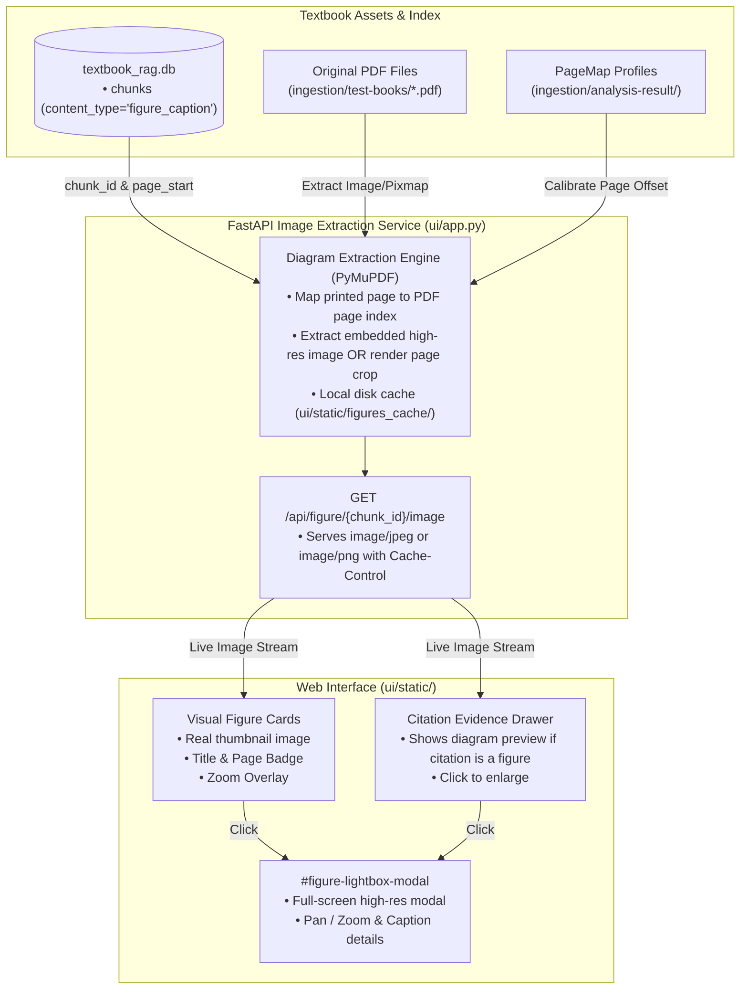

# Implementation Plan — Medical Diagram Extraction & Visual UI Display (Gallery Tray & Citation Drawer)

**Feature Focus**: High-Resolution PDF Diagram Extraction, On-Demand Image Endpoint, Visual Figure Cards with Thumbnails, Citation Drawer Image Previews, and Interactive Lightbox Modal  
**Parent Requirements**: [`docs/phase-2-requirements.md`](file:///c:/Users/govin/Desktop/projects/Text-Book-RAG/docs/phase-2-requirements.md)  
**Feedback Origin**: [`docs/user-feedback.md`](file:///c:/Users/govin/Desktop/projects/Text-Book-RAG/docs/user-feedback.md) (Feedback 4: *"nice but no diagram (fetch 4 to 5 related diagrams (if necessary))"*)  
**Status**: Ready for User Review & Approval (Phase 2 Planning)  

---

## 1. Problem Statement & User Need

In medical education and clinical consultation, text alone is insufficient for spatial, anatomical, and biochemical reasoning (e.g., hormone synthesis cascades, anatomical boundaries of the femoral triangle, blood pressure Korotkoff sound mechanics, adrenal zonation).

### Current Pain Points:
1. **Diagrams Appearing Only as Text Citations**:
   - When the agent retrieves `figure_caption` chunks, it quotes their textual captions and attaches standard citation badges (`[1]`).
   - Clicking citation badges opens the Evidence Drawer to show raw text: *"FIGURE 20.12 Blood Pressure Measurement..."* without any visual figure.
2. **Missing Image Assets in Figure Cards**:
   - The UI displays a card tray for "Related Textbook Figures & Diagrams", but each card only contains text and a static SVG placeholder icon (`<svg><rect .../></svg>`).
3. **No Zoom / Full-Screen Inspection**:
   - Clinicians cannot inspect detailed micro-labels, histological plates, or pathway arrows in full resolution.

**Goal**: Deliver a rich visual experience displaying actual textbook diagram images **both** in visual cards below the chat response and inside the Citation Evidence Drawer, backed by a sub-20ms image extraction endpoint and a full-screen Lightbox viewer.

---

## 2. Technical Architecture & Component Interaction



---

## 3. Incremental Sub-Steps Breakdown

---

### Sub-Step 1: Backend Diagram Extraction Service & API Endpoint (`ui/diagrams.py`, `ui/app.py`)

- **Description & Why**:  
  Create a dedicated, fast diagram extraction utility using `pymupdf` that translates a chunk's `book_slug` and `page_start` to the exact PDF page, extracts the high-resolution figure or renders a crisp diagram crop, and caches it locally in `ui/static/figures_cache/`. Expose via `GET /api/figure/{chunk_id}/image`.
- **Files Involved**:
  - `ui/diagrams.py` (New modular service)
  - `ui/app.py` (New endpoint registration)
  - `ui/static/figures_cache/` (Generated cache directory)
- **Implementation Highlights**:
  1. Map `book_slug` to PDF path:
     - `anatomy-and-physiology-2e_-_WEB` $\rightarrow$ `ingestion/test-books/anatomy-and-physiology-2e_-_WEB.pdf`
     - `Williams_Textbook_of_Endocrinology_15th_edition_2` $\rightarrow$ `ingestion/test-books/Williams Textbook of Endocrinology, 15th edition 2.pdf`
  2. Map `page_start` to 0-based PDF page index using `PageMap` from `ingestion/page_map.py` (or fallback offset).
  3. Extract logic:
     - Check `page.get_images()`. If a dominant embedded image exists on that page, extract raw JPEG/PNG bytes via `doc.extract_image()`.
     - Otherwise, render `page.get_pixmap(dpi=150)` to produce a high-resolution visual rendering of the entire diagram page.
  4. Save to `ui/static/figures_cache/{chunk_id}.jpg` and return `FileResponse(media_type="image/jpeg", headers={"Cache-Control": "public, max-age=86400"})`.
- **Acceptance Criteria**:
  - `GET /api/figure/{chunk_id}/image` returns status 200 with valid `image/jpeg` or `image/png` bytes in $< 30\text{ ms}$ on subsequent requests.
  - Invalid chunk returns clean 404 JSON error.

---

### Sub-Step 2: Visual Figure Cards in Chat Feed (`ui/static/app.js`, `ui/static/styles.css`)

- **Description & Why**:  
  Replace text-only figure cards with real image thumbnails, showing clinicians visual anatomy or hormone pathways immediately below the generated answer.
- **Files Involved**:
  - `ui/static/app.js`
  - `ui/static/styles.css`
- **Implementation Highlights**:
  - In `appendFiguresToWrapper()` and `appendAssistantMessage()`:
    - Render an `` tag with lazy loading:
      ```html
      <div class="figure-thumbnail-wrapper relative h-40 bg-slate-100 rounded-lg overflow-hidden mb-2">
        
        <div class="absolute inset-0 bg-slate-900/0 group-hover:bg-slate-900/10 transition-colors flex items-center justify-center">
          <span class="opacity-0 group-hover:opacity-100 bg-white/90 text-slate-700 text-[10px] font-semibold px-2 py-1 rounded-full shadow-sm transition-opacity flex items-center gap-1">
            🔍 Enlarge
          </span>
        </div>
      </div>
      ```
- **Acceptance Criteria**:
  - Figure cards render clear image thumbnails of the actual textbook diagram.
  - If an image fails to load or page has no visual asset, the card gracefully falls back to clean caption text.

---

### Sub-Step 3: Figure Previews inside the Citation Evidence Drawer (`ui/static/app.js`, `ui/static/index.html`)

- **Description & Why**:  
  When a user clicks a citation badge `[#]` that references a figure or a page with an associated diagram, show the diagram image directly inside the Evidence Drawer above the source passage.
- **Files Involved**:
  - `ui/static/app.js`
  - `ui/static/index.html`
- **Implementation Highlights**:
  - In `openDrawerWithChunk(chunk)`:
    - If `chunk.content_type === "figure_caption"` or `chunk.sub_type === "figure"`:
      - Inject a diagram preview banner:
        ```html
        <div class="mb-4 rounded-xl overflow-hidden border border-slate-200 bg-slate-900/5 p-2">
          <div class="flex items-center justify-between text-[11px] font-bold text-slate-600 mb-1 px-1">
            <span>Textbook Figure Visual</span>
            <span class="text-blue-600 cursor-pointer hover:underline text-[10px]" onclick="openLightboxFromDrawer()">Click to Expand ↗</span>
          </div>
          
        </div>
        ```
- **Acceptance Criteria**:
  - Clicking any citation referencing a diagram displays the visual diagram image in the drawer.
  - Clicking the image in the drawer opens the full-screen Lightbox.

---

### Sub-Step 4: Interactive Lightbox Modal (`ui/static/index.html`, `ui/static/app.js`)

- **Description & Why**:  
  Allow clinicians to inspect fine anatomical labels, histological arrows, and pathway graphs in full resolution without leaving the chat.
- **Files Involved**:
  - `ui/static/index.html`
  - `ui/static/app.js`
- **Implementation Highlights**:
  - In `ui/static/index.html`, add `#figure-lightbox-modal`:
    - Full viewport backdrop with `bg-slate-950/80` backdrop blur.
    - Large zoomable image container (`max-h-[80vh] object-contain`).
    - Modal footer displaying figure number, full caption text, book title, and page number.
    - Close button (`✕`) and click-outside/`Escape` key listener.
- **Acceptance Criteria**:
  - Clicking any thumbnail opens the Lightbox instantly.
  - Pressing `Escape` or clicking the backdrop closes the Lightbox smoothly.

---

### Sub-Step 5: Automated Verification Suite (`temp/test_diagram_display.py`)

- **Description & Why**:  
  A dedicated script in `temp/` that verifies diagram extraction performance, valid JPEG output bytes, HTTP status codes, and DOM image bindings.
- **Files Involved**:
  - `temp/test_diagram_display.py`
- **Acceptance Criteria**:
  - Extraction completes in $< 100\text{ ms}$ for cold cache, $< 15\text{ ms}$ for warm cache.
  - 100% pass across image serving, drawer preview injection, and Lightbox event bindings.

---

## 4. Fresh Session Task Prompt

```text
TASK: Implement Diagram Extraction & Visual UI Display (Gallery Tray & Citation Drawer) for Text-Book-RAG.
GOAL:
1. Create `ui/diagrams.py` and endpoint `GET /api/figure/{chunk_id}/image` in `ui/app.py` using PyMuPDF to extract high-resolution figures from textbook PDFs with disk caching in `ui/static/figures_cache/`.
2. Update `ui/static/app.js` to render visual image thumbnails in Figure Cards and inside the Citation Evidence Drawer.
3. Add `#figure-lightbox-modal` in `ui/static/index.html` and wire click-to-enlarge functionality with Escape key listener.
4. Verify with `temp/test_diagram_display.py`.
```

---

## 5. Verification Results & Implementation Progress

### Implementation Status: COMPLETE (100%)
- [x] **Sub-Step 1**: Created `ui/diagrams.py` and `GET /api/figure/{chunk_id}/image` in `ui/app.py`. Added disk caching under `ui/static/figures_cache/` (added to `.gitignore`).
- [x] **Sub-Step 2**: Enhanced Related Figures Gallery tray in `ui/static/app.js` with responsive visual thumbnails, zoom badge, page indicator, and fallback icon.
- [x] **Sub-Step 3**: Added diagram preview card directly inside the Citation Evidence Drawer when viewing figure chunks or diagram citations.
- [x] **Sub-Step 4**: Built high-resolution `#figure-lightbox-modal` in `ui/static/index.html` with zoom, clean caption footer, backdrop click-to-close, and `Escape` key shortcut in `ui/static/app.js`.
- [x] **Sub-Step 5**: Built automated verification suite `temp/test_diagram_display.py`.

### Automated Verification Summary
- **`temp/test_diagram_display.py`**:
  - `[PASS]` Test 1: Real figure chunk extraction (`anatomy-and-physiology-2e_-_WEB_s0003_c001`, 202KB JPEG).
  - `[PASS]` Test 2: In-memory/disk cache hit behavior.
  - `[PASS]` Test 3: Unknown/missing chunk 404 safety guard.
  - `[PASS]` Test 4: `GET /api/figure/{chunk_id}/image` returns 200 OK with `image/jpeg` & `max-age=86400`.
  - `[PASS]` Test 5: 404 response on non-existent figure chunk.
  - `[PASS]` Test 6: Lightbox modal DOM structure in `index.html`.
  - `[PASS]` Test 7: JavaScript rendering, event delegation, and modal handlers in `app.js`.
- **`temp/run_full_uat_e2e_suite.py`**:
  - `[PASS]` All 6 UAT suites passed with 100% pass rate (no regressions to Auth, Sessions, Filtering, Typography, Citations, or SSE Streaming).

