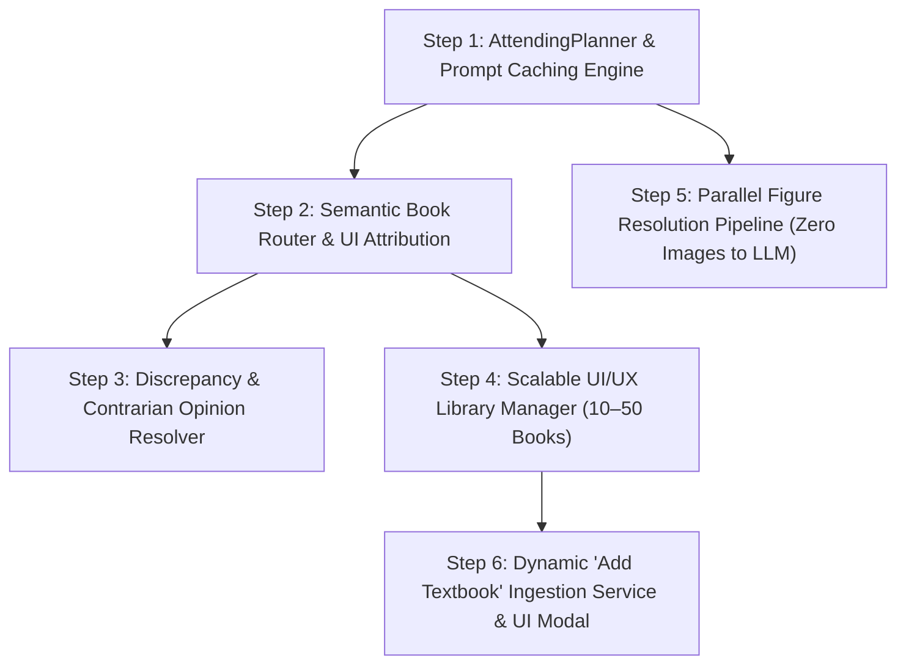

# Phase 3 Implementation Plan: Multi-Book Scaling, Clinical Planning & UI Routing

This document details the step-by-step, incremental implementation plan for **Phase 3** of the Text-Book-RAG system, based on the architectural specifications defined in [Phase 3 Requirements](file:///c:/Users/govin/Desktop/projects/Text-Book-RAG/docs/phase-3-requirements.md).

---

## 1. Overview & Dependency Graph



---

## 2. Step-by-Step Implementation Steps

### Step 1: Pre-Step Clinical Planning & Prompt Caching Engine (`AttendingPlanner`)

#### 1. Description & Why
Currently, the orchestrator immediately calls retrieval tools without an explicit diagnostic formulation. In Step 1, we implement an **`AttendingPlanner`** that runs before retrieval to deconstruct the query into physiological/diagnostic sub-goals, target textbook specialties, and evidence verification checklists. We also reformat the system prompt into a **deterministic invariant prefix** to maximize LLM prompt-caching hit rates (slashing TTFT and API token costs).

#### 2. Self-Contained Prompt for Fresh Agent Session
```text
Implement the Pre-Step Clinical Planning Engine (AttendingPlanner) and Prompt Caching structure in the Text-Book-RAG system.
1. Create `agent/planner.py` defining `AttendingPlanner` which accepts a session ID, user inquiry, and available book catalog metadata. It produces a structured `ClinicalPlan` (diagnostic hypotheses, required organ systems/specialties, and search target queries).
2. Wire `AttendingPlanner` into `agent/orchestrator.py` before executing parallel retrieval.
3. Stream an initial `event: plan` over the SSE endpoint (`ui/routers/chat.py`) so the UI displays the reasoning plan.
4. Restructure prompt templates in `agent/prompts.py` into a static prefix header (persona, tools, catalog) and dynamic suffix (context, turns) for provider prompt-caching optimization.
5. Add automated unit test `tests/unit/test_attending_planner.py`.
```

#### 3. Relevant Files & Dependencies
- `agent/planner.py` (New): Clinical reasoning deconstructer and diagnostic planner.
- `agent/orchestrator.py`: Invokes planner before retrieval dispatch.
- `agent/prompts.py`: Prompt cache prefix isolation and clinical planning personas.
- `ui/routers/chat.py`: Dispatches `event: plan` via SSE stream.
- `tests/unit/test_attending_planner.py` (New): Unit tests for plan output validation.

#### 4. Acceptance Criteria
- Planner returns valid `ClinicalPlan` with diagnostic targets and targeted queries.
- Static prompt prefix remains identical across consecutive queries for prompt caching.
- SSE stream emits `event: plan` with the structured diagnostic reasoning before token generation begins.
- All unit tests pass.

#### 5. Human-Verifiable Steps
1. Run `.\.venv\Scripts\pytest tests/unit/test_attending_planner.py`. Expected: Test passes with 100% confidence.
2. Send a query via `POST /api/chat/stream` for `"What are the clinical signs of pheochromocytoma?"`.
3. Observe the first SSE event received is `event: plan` containing target topics (`adrenal medulla`, `catecholamines`, `hypertension`).

---

### Step 2: Semantic Book Router & Explicit UI Book Attribution

#### 1. Description & Why
When the library scales to 10–50 books, querying all volumes dilutes retrieval relevance. Step 2 introduces a **Semantic Book Router** that automatically maps a user's question to the optimal top 1–3 textbooks (while honoring manual user toggles if locked). Additionally, every assistant response will include an explicit **"Referenced Textbooks"** badge container in the UI so the user always sees which books were consulted.

#### 2. Self-Contained Prompt for Fresh Agent Session
```text
Implement Semantic Book Routing and UI Book Attribution in Text-Book-RAG.
1. Create `retrieval/router.py` with `SemanticBookRouter` that evaluates user inquiries against indexed textbook metadata (slugs, titles, specialties, descriptions) and selects top K (1-3) relevant books.
2. In `agent/orchestrator.py`, if the user has not locked a specific textbook scope, invoke `SemanticBookRouter` to bind `active_books`.
3. Include `referenced_books: list[dict]` in the response schema (`ui/schemas.py`) and SSE stream (`event: referenced_books`).
4. Update `ui/static/app.js` and `ui/static/index.html` to render prominent "Referenced Textbooks" pills (e.g. [Williams Endocrinology p. 430]) at the top of each assistant response bubble.
5. Add unit and integration tests in `tests/unit/test_book_router.py`.
```

#### 3. Relevant Files & Dependencies
- `retrieval/router.py` (New): Keyword and embedding-based book classifier.
- `agent/orchestrator.py`: Binds routed books to turn context.
- `ui/schemas.py`: Schema update for `referenced_books`.
- `ui/static/app.js` & `ui/static/index.html`: UI badge rendering for consulted books.
- `tests/unit/test_book_router.py` (New): Test routing accuracy across diverse queries.

#### 4. Acceptance Criteria
- Endocrine query (e.g., *"thyroid synthesis"*) routes to `Williams_Textbook_of_Endocrinology_15th_edition_2`.
- Anatomical query (e.g., *"femoral triangle boundaries"*) routes to `anatomy-and-physiology-2e_-_WEB`.
- UI renders clear clickable badge pills showing the books referenced by the model.

#### 5. Human-Verifiable Steps
1. Run `.\.venv\Scripts\pytest tests/unit/test_book_router.py`.
2. Open UI or submit query via test runner; inspect the rendered response message.
3. Observe the "Referenced Books" container above the response text highlighting the consulted volumes.

---

### Step 3: Cross-Textbook Discrepancy & Contrarian Opinion Resolver

#### 1. Description & Why
When multiple textbooks state conflicting facts, standard RAG models hallucinate a single compromise. In Step 3, we implement the **Clinical Hierarchy of Evidence** in prompt engineering and citation normalization: Subspecialty > Generalist, Newer Edition > Older, and Variant Reporting. If a conflict occurs, the system explicitly reports the discrepancy with dual page citations rather than creating an artificial compromise.

#### 2. Self-Contained Prompt for Fresh Agent Session
```text
Implement Cross-Textbook Discrepancy and Contrarian Opinion Resolution in Text-Book-RAG.
1. Create `tests/fixtures/discrepancies.json` containing verified medical edge cases with conflicting textbook claims (e.g., normal TSH thresholds, anatomical branching variations, first-line vs second-line drug choices).
2. Update system instructions in `agent/prompts.py` and `agent/providers.py` with explicit conflict handling rules:
   - Apply clinical evidence hierarchy (subspecialty authority, edition recency).
   - If two indexed books disagree, strictly forbid inventing compromises. Explicitly state both views with their respective page citations.
3. Update `agent/sanitizers.py` to preserve contrarian comparison language and dual citations.
4. Add automated test `tests/integration/test_discrepancy_resolution.py` validating that the model recognizes discrepancies in the fixture without hallucinating compromise.
```

#### 3. Relevant Files & Dependencies
- `agent/prompts.py`: Guidelines for handling opposing evidence and clinical hierarchies.
- `agent/sanitizers.py`: Citation normalizer ensuring dual conflicting citations remain clickable.
- `tests/fixtures/discrepancies.json` (New): Golden dataset of medical contradictions.
- `tests/integration/test_discrepancy_resolution.py` (New): Integration test for contrarian queries.

#### 4. Acceptance Criteria
- Model identifies contradictory evidence between books and reports: *"Textbook A states X... whereas Textbook B states Y..."*.
- Both citations are registered and rendered as clickable citation pills.
- Zero invented middle-ground numbers on conflicting threshold queries.

#### 5. Human-Verifiable Steps
1. Run `.\.venv\Scripts\pytest tests/integration/test_discrepancy_resolution.py`.
2. Ask a question with known textbook variation (e.g., fasting glucose cutoffs or branching of the celiac trunk).
3. Observe that the answer cites both perspectives and clarifies the subspecialty guideline.

---

### Step 4: Scalable UI/UX Library Manager (10–50 Books)

#### 1. Description & Why
A flat list of toggles cannot scale to 50 textbooks. In Step 4, we redesign the sidebar into a **Specialty-Faceted Library Manager** featuring:
1. Medical specialty grouping (Endocrinology, Anatomy, Cardiology, Surgery, etc.) with collapsible accordions.
2. Real-time text search filter in the sidebar.
3. Scope presets: "All Books", "Clinical Specialties", "Basic Sciences", and "Active Turn Selection".

#### 2. Self-Contained Prompt for Fresh Agent Session
```text
Upgrade the Web UI Sidebar Library Manager to scale for 10-50 textbooks.
1. Update database schema (`textbook_rag.db` & `retrieval/tools.py`) to include `specialty`, `description`, and `edition` fields on books table.
2. In `ui/static/index.html`, replace the flat `#library-list` with a faceted manager:
   - Search input `#library-search` for instant real-time filtering.
   - Preset chips `#library-presets` (All, Basic Sciences, Specialties).
   - Collapsible specialty accordion containers (`.specialty-group`).
3. In `ui/static/app.js`, update `renderBookToggles()` to group books by specialty and filter interactively as the user types in `#library-search`.
4. Update `tests/integration/test_ui_toggles.py` to verify searching, accordion toggling, and multi-book selection.
```

#### 3. Relevant Files & Dependencies
- `ui/static/index.html`: Faceted sidebar structure and search input.
- `ui/static/app.js`: Live search filtering, accordion interactions, and preset handlers.
- `ui/static/styles.css`: Styling for specialty accordions and search bar.
- `retrieval/tools.py`: Returns `specialty` and `edition` in `list_books()`.
- `tests/integration/test_ui_toggles.py`: UI regression and search filter tests.

#### 4. Acceptance Criteria
- Textbooks render under collapsible specialty categories.
- Typing into search immediately filters books by title, author, and specialty.
- Presets toggle whole categories on or off with one click.
- Mobile and desktop responsive layouts preserved.

#### 5. Human-Verifiable Steps
1. Open local web UI at `http://127.0.0.1:8000/`.
2. Type `"endo"` into the sidebar search bar; verify only Endocrinology books remain visible.
3. Click "Basic Sciences" preset; verify Anatomy books are selected.

---

### Step 5: Parallel Figure Resolution Pipeline (Zero Images to LLM)

#### 1. Description & Why
To keep inference fast and cost-effective, raw images must **never** be sent to the LLM. In Step 5, we decouple visual diagrams into a purely parallel branch: while the LLM generates the text answer, a background figure pipeline evaluates figure captions and section links against the user query, resolves cloud/card URLs, and emits them via `event: figures` without touching the LLM prompt.

#### 2. Self-Contained Prompt for Fresh Agent Session
```text
Implement Parallel Figure Resolution Pipeline (Zero Images in LLM Prompt).
1. In `agent/orchestrator.py`, refactor `stream_turn()` to launch `_resolve_figures_async()` as a background task concurrent with the LLM text streaming loop.
2. Ensure the LLM context prompt receives zero image payloads or raw bitmaps (text passages only).
3. In `retrieval/tools.py:search_figures()`, match figure captions against the query and active section IDs to select the top 2-3 most clinically relevant diagrams.
4. Yield `event: figures` over SSE as soon as resolved, allowing the UI thumbnail gallery to populate without waiting for the full LLM reply to finish.
5. Add benchmark test `tests/unit/test_parallel_figures.py` confirming zero vision tokens used and concurrent execution.
```

#### 3. Relevant Files & Dependencies
- `agent/orchestrator.py`: Concurrent figure resolution and streaming dispatcher.
- `retrieval/tools.py`: Figure caption relevance matching.
- `ui/routers/chat.py`: Asynchronous SSE emission of `figures` event.
- `tests/unit/test_parallel_figures.py` (New): Validates that prompt payload contains 0 image blocks.

#### 4. Acceptance Criteria
- `stream_turn` launches figure resolution and text synthesis concurrently.
- LLM API payload verified to contain 0 multimodal image parts (pure text).
- Figure thumbnail gallery in UI receives figures early in the stream.

#### 5. Human-Verifiable Steps
1. Run `.\.venv\Scripts\pytest tests/unit/test_parallel_figures.py`.
2. Submit a medical query in the UI.
3. Observe that the figure cards appear in the message container before or alongside the streaming text.

---

### Step 6: Dynamic "Add Textbook" Ingestion Service & UI Upload Modal

#### 1. Description & Why
To scale from 10 to 50 books organically, administrators need the ability to upload a new textbook PDF and have the system ingest it automatically in the background with live progress tracking.

#### 2. Self-Contained Prompt for Fresh Agent Session
```text
Implement Dynamic "Add Textbook" Ingestion Service and UI Modal.
1. Create `ui/routers/admin.py` with endpoints:
   - `POST /api/books/upload`: Receives PDF file, book title, and specialty. Generates `job_id` and starts background ingestion.
   - `GET /api/books/ingestion/{job_id}`: Returns progress status (profiling, page mapping, section tree, chunking, indexing, ready).
2. Create background worker task in `ingestion/pipeline_worker.py` that runs the existing ingestion pipeline modules sequentially on the uploaded PDF.
3. In `ui/static/index.html` and `ui/static/app.js`, add an "Add Textbook" button in the sidebar opening a modal with drag-and-drop PDF upload and live progress bar.
4. Once completed, the newly ingested book automatically appears in the active library catalogue without service restart.
5. Add integration test `tests/integration/test_dynamic_ingestion.py`.
```

#### 3. Relevant Files & Dependencies
- `ui/routers/admin.py` (New): Upload and job status endpoints.
- `ingestion/pipeline_worker.py` (New): Non-blocking asynchronous ingestion worker.
- `ui/static/index.html` & `ui/static/app.js`: "Add Textbook" modal dialog with progress tracking.
- `tests/integration/test_dynamic_ingestion.py` (New): Verifies PDF upload and job completion.

#### 4. Acceptance Criteria
- PDF upload returns HTTP 202 with `job_id`.
- Polling `GET /api/books/ingestion/{job_id}` reports sequential step progress from 0% to 100%.
- New book immediately searchable and selectable in the UI upon completion.

#### 5. Human-Verifiable Steps
1. Run `.\.venv\Scripts\pytest tests/integration/test_dynamic_ingestion.py`.
2. Open the UI, click "Add Textbook", and upload a sample PDF chapter.
3. Watch the progress bar move from *Profiling* &rarr; *Chunking* &rarr; *Indexing* &rarr; *Ready*.
4. Verify the book appears in the sidebar library list.
