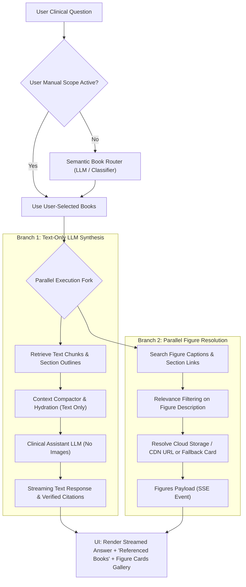

# Phase 3 Requirements: Multi-Book Scaling, Dynamic Ingestion & UI Book Routing

## 1. Executive Summary & Scaling Motivation

In Phases 1 and 2, the system was designed and verified for a dual-textbook baseline (*Anatomy and Physiology 2e* and *Williams Textbook of Endocrinology*). In **Phase 3**, the system must scale to support a library of **10 to 50 medical and academic textbooks**.

Scaling to 50 textbooks introduces three fundamental architectural bottlenecks that cannot be handled by the existing design:
1. **Diagram & Media Storage Explosion**: Storing pre-extracted figure JPEGs in the application repository or on ephemeral server instances (e.g., Render) does not scale. 50 textbooks contain ~40,000+ figures (~8–15 GB), requiring decoupled media storage or on-demand synthesis.
2. **UI Real Estate & Scope Management**: A simple vertical switch list for 50 textbooks overwhelms the sidebar and makes manual toggling impractical.
3. **Retrieval Efficiency & LLM Focus**: Searching across 50 books simultaneously causes vector noise, FTS rank dilution, and token bloat. The system requires an **Intelligent Book Routing Layer** where the agent semantically identifies and displays which specific books to query for any given clinical inquiry.

---

## 2. Core Functional Requirements

### FR-1: Dynamic "Add Textbook" Ingestion Pipeline
* **Upload & Registration**: Provide an administrative/authorized interface (`POST /api/books/upload`) to submit a new textbook PDF and optional publisher Table of Contents metadata.
* **Asynchronous Pipeline Execution**: Trigger background ingestion jobs via worker/task queue (extracting structure, page mapping, section tree construction, semantic tagging, chunking, and database indexing).
* **Ingestion Progress Tracking**: Expose a status endpoint (`GET /api/books/ingestion/{job_id}`) reporting step-by-step progress (`profiling` → `extracting` → `tagging` → `chunking` → `indexing` → `ready`).
* **Instant Catalogue Availability**: Once indexed, the book automatically appears in the UI library catalogue without requiring service restarts.

---

### FR-2: Scalable Diagram & Media Architecture
* **Decoupled Cloud Object Storage**: Replace Git-tracked static figure caching with S3-compatible cloud object storage (AWS S3, Cloudflare R2, or Google Cloud Storage) using content-hash naming (`{book_slug}/{chunk_id}.jpg`).
* **On-Demand Extraction & Presigned URLs**:
  - When a figure chunk is indexed, extract the image on-the-fly or in background workers and push to Cloud Object Storage.
  - Return authenticated or CDN-backed URLs to the client.
* **Visual Synthesis Fallback**: When source PDFs are offline, dynamically generate stylized clinical diagram cards from structured figure captions and metadata so the UI never displays broken image states.

---

### FR-3: Scalable UI/UX Library Manager (10–50 Books)
* **Categorized Faceting by Medical Specialty**:
  - Group books by medical specialty (e.g., *Endocrinology*, *Anatomy & Physiology*, *Cardiology*, *Neurology*, *Pharmacology*, *Surgery*).
  - Collapsible specialty accordions in the sidebar.
* **Instant Catalogue Search**: Search filter box in the sidebar to filter textbooks by title, subject, edition, or author.
* **Preset Library Scopes**:
  - Quick presets: "All Books", "Clinical Specialties", "Basic Sciences", "Custom Selection".
  - Persistent user scope saved in local storage or user profile.

---

### FR-4: Intelligent Book Routing & LLM Reference Representation
* **Two-Stage Retrieval with Semantic Book Router**:
  1. **Routing Stage**: A lightweight routing prompt or classifier inspects the user query, evaluates textbook descriptions/specialties, and selects the optimal $K$ books (e.g., top 1–3 relevant books out of 50).
  2. **Retrieval Stage**: Parallel retrieval executes strictly within the routed subset, preventing cross-domain noise and token dilution.
* **Explicit UI Book Attribution**:
  - Every assistant response must visibly display a **Referenced Books pill container** at the top or bottom of the message (e.g., `Referenced Textbooks: [Williams Endocrinology (p. 430)] [Anatomy & Physiology (p. 697)]`).
  - Users can clearly see which textbooks the LLM selected and consulted for that answer.
* **User Override**: If a user manually locks the scope to specific books, the router respects the user's manual filter.

---

### FR-5: Text-Only LLM Inference with Parallel Figure Resolution
* **Zero Image Transmission to LLM (Token & Cost Efficiency)**:
  - **Never transmit raw image bytes or bitmap payloads to the LLM context window.**
  - Sending high-resolution textbook images directly to multimodal LLMs incurs severe latency penalties (5–10x TTFT degradation), wastes millions of vision tokens, and is completely unnecessary.
  - Medical textbooks already feature comprehensive, peer-reviewed figure captions, anatomical legends, and surrounding section prose that explain the exact visual content.
* **Caption-to-Text Semantic Matching**:
  - Figures are semantically associated with their parent sections, subsections, and surrounding text chunks in the database.
  - Figure relevance is determined purely via text matching: the system compares the user's inquiry with the figure caption, heading taxonomy, and referenced section text. If the description is clinically relevant, the figure is selected.
* **Concurrent Execution (Parallel Figure Pipeline)**:
  - Figure resolution executes **in parallel** with the primary LLM synthesis stream.
  - The LLM synthesizes the clinical answer using bounded text passages.
  - Concurrently, the background figure pipeline matches relevant captions, resolves object storage / CDN URLs or fallback cards, and delivers them via the streaming `figures` SSE event directly to the UI (for thumbnail cards, drawer evidence, and lightbox preview) without blocking or bloating the LLM prompt.

---

### FR-6: Pre-Step Clinical Planning & Reasoning Orchestration (`AttendingPlanner`)
* **Beyond Reactive Tool-Calling**: Standard single-turn ReAct often jumps prematurely into search without understanding clinical scope. Phase 3 implements an explicit **Pre-Step Clinical Planner** (`AttendingPlanner`) that runs before retrieval:
  1. *Deconstruction*: Analyzes the patient/clinical inquiry into underlying pathophysiology, diagnostic criteria, or pharmacological targets.
  2. *Targeted Formulation*: Determines the exact target books, sections, and search hypotheses needed.
  3. *Evidence Checklist*: Formulates acceptance criteria the retrieved evidence must satisfy before drafting the answer.
* **Role Taxonomy & Clinical Hierarchy Naming**:
  - **`AttendingPlanner`**: Formulates diagnostic reasoning strategy, selects target volumes, and generates search plan.
  - **`ConsultantRetriever`**: Executes parallel structure-aware searches (`search_sections`, `search_chunks`, `read_section`).
  - **`DifferentialSynthesizer`**: Compiles the final grounded clinical consensus with verified citations.

---

### FR-7: Deterministic Prompt Caching Architecture
* **Static Prefix Isolation**: Structure the prompt layout so that invariant system instructions, clinical persona, guidelines, and textbook catalog metadata reside at the **head** of the prompt.
* **Dynamic Suffix Appending**: Dynamic user messages, retrieved section context, and tool outputs are appended strictly at the **tail**.
* **Provider Cache Optimization**: Maximizes prompt-caching hit rates (e.g., Google Gemini context caching, Anthropic prompt caching), slashing Time-To-First-Token (TTFT) by 3–4x and lowering per-query token costs by up to 80%.

---

### FR-8: Cross-Textbook Discrepancy & Contrarian Opinion Resolution
* **Handling Textbook Disagreements**: In a 50-book library, textbooks will inevitably provide conflicting data (e.g., differing diagnostic cutoffs, conflicting classification schemes, or updated pharmacological lines of therapy).
* **Clinical Hierarchy of Evidence**:
  1. *Subspecialty Authority*: Subspecialty gold-standard volumes (e.g., *Williams Endocrinology*) supersede generalist texts (e.g., *Anatomy & Physiology*) on specialized pathophysiological nuances.
  2. *Recency & Professional Society Consensus*: Newer textbook editions and updated guidelines supersede historical editions.
  3. *Variant Recognition*: Anatomical or physiological variations must be presented as documented clinical variants rather than contradictions.
* **Anti-Hallucination & Discrepancy Transparency**: The model must **never invent a compromise** between conflicting sources. It must explicitly highlight the discrepancy:
  > *"Note: Textbook sources present differing criteria on this threshold. According to Williams Endocrinology (p. 604)... whereas Anatomy & Physiology (p. 712) states... In clinical practice, the subspecialty guideline is typically prioritized."*

---

### FR-9: Domain-Expert Evaluation & Credibility Rubric
* **Grounding Fidelity (1–5)**: Every medical assertion must be strictly supported by an exact section/page citation.
* **Nuance & Discrepancy Detection (1–5)**: Does the system accurately recognize and surface conflicting opinions between textbooks?
* **Absence of Extrapolation (1–5)**: Does the system refuse to fabricate facts outside the indexed source material?
* For full questionnaire and clinician interview protocol, see [Physician Domain-Expert Questionnaire](file:///c:/Users/govin/Desktop/projects/Text-Book-RAG/docs/physician-questionnaire.md).

---

## 3. Architecture & Data Flow



---

## 4. Proposed Database Schema Additions

### `books` Table Updates
```sql
ALTER TABLE books ADD COLUMN specialty TEXT;          -- e.g. 'Endocrinology', 'Anatomy'
ALTER TABLE books ADD COLUMN description TEXT;        -- Concise summary for LLM Router
ALTER TABLE books ADD COLUMN cover_image_url TEXT;    -- Optional cover preview
ALTER TABLE books ADD COLUMN ingestion_status TEXT;   -- 'pending', 'processing', 'ready', 'failed'
ALTER TABLE books ADD COLUMN created_at TIMESTAMP DEFAULT CURRENT_TIMESTAMP;
```

### `ingestion_jobs` Table
```sql
CREATE TABLE IF NOT EXISTS ingestion_jobs (
    id TEXT PRIMARY KEY,
    book_slug TEXT NOT NULL,
    file_name TEXT NOT NULL,
    file_size_bytes INTEGER,
    status TEXT NOT NULL,                             -- 'queued', 'extracting', 'chunking', 'indexing', 'completed', 'failed'
    current_step TEXT,
    progress_pct REAL DEFAULT 0.0,
    error_message TEXT,
    created_at TIMESTAMP DEFAULT CURRENT_TIMESTAMP,
    updated_at TIMESTAMP DEFAULT CURRENT_TIMESTAMP
);
```

---

## 5. Phased Implementation Roadmap

| Milestone | Scope & Deliverables | Verification Criteria |
| :--- | :--- | :--- |
| **Step 3.1: Library Scaling & Specialty Faceting UI** | Update sidebar UI with search, specialty filtering, and collapsible categories for 10–50 books. | UI smoothly displays 20+ mock/real books with instant search and accordion grouping. |
| **Step 3.2: Semantic Book Router & UI Reference Attribution** | Implement lightweight Book Router in `agent/orchestrator.py` and display referenced books badges in message responses. | Query "Graves disease" automatically routes to Endocrinology book; response renders active reference badges. |
| **Step 3.3: Decoupled Cloud Media Storage for Diagrams** | Integrate S3/R2 storage adapter for figure images; remove static cache from repository tracking. | Images serve from object storage; fallback card renders if asset missing. |
| **Step 3.4: Dynamic "Add Textbook" Ingestion Pipeline** | Upload endpoint, background worker for PDF ingestion, and progress monitoring modal in UI. | User uploads new PDF; progress bar updates; new book becomes searchable in UI. |

---

## 6. Shared Decisions & Constraints

1. **Repository Cleanliness**: The Git repository will **never** store PDFs or gigabytes of figure images. Media must reside in object storage or be synthesized on demand.
2. **Search Quality at 50 Books**: Do not perform brute-force search over all 50 books simultaneously. Semantic book routing is mandatory before executing chunk/section retrieval.
3. **Transparency**: The user must always see which textbooks the model chose to consult for each response.
4. **No Raw Images in LLM Context**: Under no circumstances are raw image bytes or bitmap payloads passed to the LLM. LLM inference remains 100% text-based, saving tokens and latency. Figure relevance is evaluated exclusively through caption descriptions, section headings, and linked body text.
5. **Parallel Figure Pipeline**: Figure matching and media URL resolution must run concurrently with LLM answer streaming so visual diagrams are delivered to the UI without slowing down text generation.

