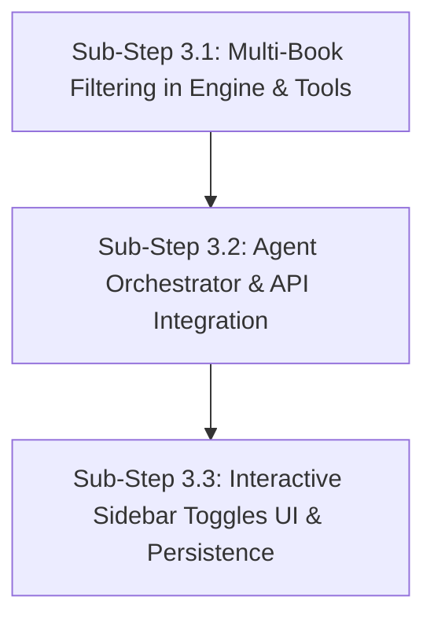

# Implementation Plan — Step 3: Global Library Toggles & Scope Filtering

**Step Focus**: User-Level Textbook Toggling, Multi-Book Filtering in Retrieval Engine, Persistent Scope Preferences  
**Parent Document**: [`docs/phase-2-requirements.md`](file:///c:/Users/govin/Desktop/projects/Text-Book-RAG/docs/phase-2-requirements.md)  
**Status: IMPLEMENTED & VERIFIED (PASS)**  

---

## 1. Problem Statement & User Requirements

During usability testing, the user noted:
> *"2) target textbook is nice, but i dont want anatomy book - i cant delete it, it is still there, i cant edit indexed, lib"*

And the user established the foundational architectural rule:
> *"keep the books global to all users, they can toggle or not no ned to delete."*

### Current State:
- All textbooks in `textbook_rag.db` (`Williams Textbook of Endocrinology`, `Anatomy and Physiology 2e`) are shared globally.
- The UI sidebar only displays a read-only list of indexed books in a collapsed `<details>` section.
- The dropdown only permits choosing either "All Ingested Volumes" (which searches everything) or a single specific book. There is no way to exclude a specific volume or select a multi-book subset.
- Backend retrieval methods (`search_sections`, `search_chunks` in `SqliteEngine` and `PostgresEngine`) only take `book_slug: str | None`. If `book_slug` is `None`, queries search every volume in the database.
- The agent orchestrator passes only `book_slug: str | None`.

### Desired End State:
- Textbooks remain permanently global and immutable on disk/database (no destructive drop/delete operations).
- In the UI sidebar, every textbook has an interactive, accessible toggle switch (ON/OFF).
- Users can toggle off *Anatomy and Physiology 2e* so it is completely excluded from search and evidence.
- The active book scope is persisted in `localStorage` across page reloads and consultations.
- When a book is toggled OFF, backend retrieval tools strictly exclude its sections and chunks across all queries, resulting in 0 citations from excluded volumes.

---

## 2. Architecture & Design Decisions

1. **Global Textbook Immutability**:
   - `textbook_rag.db` tables (`books`, `sections`, `chunks`, `chunks_fts`, `sections_fts`) remain untouched.
   - Textbooks are never deleted from disk or database. Filtering is purely a query-time scope constraint.

2. **Query-Time Multi-Book Scope Filtering**:
   - `BaseEngine`, `SqliteEngine`, and `PostgresEngine` accept `allowed_books: list[str] | None = None` alongside `book_slug: str | None = None`.
   - In SQLite:
     ```sql
     AND s.book_slug IN (?, ?, ...)
     ```
   - If `allowed_books` is an empty list `[]`, the engine short-circuits and immediately returns `[]` (safe, 0 hits, avoids invalid SQL `IN ()`).
   - If `allowed_books` is `None`, all books are included.
   - If both `book_slug` and `allowed_books` are provided, `allowed_books` intersects or takes precedence.

3. **Orchestrator Scope Enforcement**:
   - `AgentOrchestrator.run_turn(..., active_books: list[str] | None = None)`
   - Server-side enforcement: when LLM invokes tools (`search_chunks`, `search_sections`), the orchestrator automatically injects `allowed_books=active_books` into the tool arguments, ensuring the LLM cannot retrieve chunks from disabled books even if it tries.
   - In offline synthesizer mode (`_run_offline_synthesizer_turn`), tool calls pass `allowed_books=active_books`.

4. **UI Scope Management & Persistence**:
   - Replace the static library list with an interactive **Textbook Scope Manager**:
     - Toggle switches for each book with instant visual feedback (Emerald active vs. Muted excluded).
     - Status tag: `Active Scope` vs `Excluded from Search`.
     - Header scope summary: `Scope: 1 of 2 Books Active`.
     - Controls: `[Select All]` and `[Reset]`.
     - Safeguard: At least 1 textbook must remain active; attempting to uncheck all books shows an alert and prevents empty scope.
   - Stored in browser `localStorage` under key `textbook_rag_active_books`.

---

## 3. Incremental Sub-Steps



---

### Sub-Step 3.1: Multi-Book Filtering in Retrieval Engine & Tools

**Status: COMPLETED & VERIFIED (PASS)**

#### 1. Description & Why
Upgrade `BaseEngine`, `SqliteEngine`, `PostgresEngine`, and `retrieval/tools.py` to support filtering by a collection of allowed book slugs (`allowed_books: list[str] | None = None`). This enables querying any arbitrary subset of textbooks without modifying stored tables.

#### 2. Self-Contained Task Prompt for Fresh Session
```text
TASK: Implement multi-book filtering in retrieval engine and tools.
FILES: retrieval/engine.py, retrieval/tools.py
DETAILS:
1. In `retrieval/engine.py`:
   - Update `BaseEngine.search_sections` and `BaseEngine.search_chunks` to accept `allowed_books: list[str] | None = None`.
   - In `SqliteEngine.search_sections`:
     - If `allowed_books` is empty list `[]`: return [] immediately.
     - If `allowed_books` is provided: build SQL parameter placeholders `AND s.book_slug IN (?, ...)` and append to params. Apply same to fallback LIKE query.
   - In `SqliteEngine.search_chunks`:
     - If `allowed_books` is empty list `[]`: return [] immediately.
     - If `allowed_books` is provided: add `AND c.book_slug IN (?, ...)` to both FTS5 match query and fallback LIKE query.
   - In `PostgresEngine.search_sections` and `search_chunks`:
     - Support `allowed_books` using `AND book_slug = ANY(%s)`.
2. In `retrieval/tools.py`:
   - Update `search_sections` and `search_chunks` signatures to accept `allowed_books: list[str] | None = None` and forward to `_engine()`.
3. Create automated verification test in `temp/test_multi_book_filter.py`.
```

#### 3. Relevant Files & Dependencies
- `retrieval/engine.py`: `SqliteEngine`, `PostgresEngine`, `BaseEngine`
- `retrieval/tools.py`: `search_sections`, `search_chunks`
- `temp/test_multi_book_filter.py`: Automated test script

#### 4. Clear Acceptance Criteria
- `SqliteEngine.search_chunks(query="femur", allowed_books=["Williams_Textbook_of_Endocrinology_15th_edition_2"])` returns **0 hits** from Anatomy, even though "femur" is prominently in Anatomy.
- `SqliteEngine.search_chunks(query="femur", allowed_books=["anatomy-and-physiology-2e_-_WEB"])` returns chunks from Anatomy.
- `SqliteEngine.search_chunks(query="femur", allowed_books=[])` immediately returns `[]` without any SQL syntax error.
- `SqliteEngine.search_sections(query="adrenal", allowed_books=["anatomy-and-physiology-2e_-_WEB"])` returns 0 sections from Williams.
- `allowed_books=None` preserves existing behavior across all indexed books.

#### 5. Verification Results
Automated test script `temp/test_multi_book_filter.py` executed:
- `[PASS] Allowed books [Williams_Textbook_of_Endocrinology_15th_edition_2] returned 10 chunks, 0 leaked from Anatomy.`
- `[PASS] Allowed books [anatomy-and-physiology-2e_-_WEB] returned 10 chunks, 0 leaked from Endocrinology.`
- `[PASS] Empty allowed_books=[] returns empty list immediately without SQL errors.`
- `[PASS] Default allowed_books=None returned 10 chunks.`
- `[PASS] Sections restricted to [anatomy-and-physiology-2e_-_WEB] returned 1 sections, 0 leaked from Endocrinology.`
- `[PASS] retrieval.tools.search_chunks correctly enforces allowed_books filter.`
- `[PASS] retrieval.tools.search_sections correctly enforces allowed_books filter.`

---

### Sub-Step 3.2: Agent Orchestrator & API Integration

**Status: COMPLETED & VERIFIED (PASS)**

#### 1. Description & Why
Wire the user's active textbook scope from the frontend HTTP request through FastAPI (`ui/app.py`) into the agent's turn loop (`agent/orchestrator.py`). Enforce the scope on all LLM tool calls and offline synthesizer passes.

#### 2. Self-Contained Task Prompt for Fresh Session
```text
TASK: Wire active_books scope from ChatRequest to AgentOrchestrator and enforce it across tool executions.
FILES: ui/app.py, agent/orchestrator.py
DETAILS:
1. In `ui/app.py`:
   - Add `active_books: list[str] | None = None` to `ChatRequest` Pydantic model.
   - In `api_chat`, pass `active_books=req.active_books` to `orchestrator.run_turn(...)`.
2. In `agent/orchestrator.py`:
   - Update `AgentOrchestrator.run_turn` signature to accept `active_books: list[str] | None = None`.
   - In `_run_offline_synthesizer_turn`:
     - Pass `allowed_books=active_books` to `search_chunks` and `search_sections`.
   - In `_run_gemini_turn` and `_run_openai_turn`:
     - In tool execution loop, if function name is `search_chunks` or `search_sections`:
       - If `active_books` is provided, enforce `fn_args["allowed_books"] = active_books`.
3. Create automated integration test in `temp/test_agent_scope.py`.
```

#### 3. Relevant Files & Dependencies
- `ui/app.py`: `ChatRequest`, `api_chat`
- `agent/orchestrator.py`: `AgentOrchestrator.run_turn`, `_run_offline_synthesizer_turn`, `_run_gemini_turn`, `_run_openai_turn`
- `temp/test_agent_scope.py`: Integration test script

#### 4. Clear Acceptance Criteria
- Sending `{"session_id": "test", "message": "adrenal hormones", "active_books": ["Williams_Textbook_of_Endocrinology_15th_edition_2"]}` to `/api/chat` results in citations exclusively from Williams.
- Sending `active_books: ["anatomy-and-physiology-2e_-_WEB"]` returns citations exclusively from Anatomy.
- The LLM cannot bypass the active book filter because the orchestrator enforces `allowed_books` on every tool call.

#### 5. Verification Results
Automated test script `temp/test_agent_scope.py` executed:
- `[INFO] Endocrinology-only query returned 4 citations.`
- `[PASS] Agent turn with Endocrinology-only scope returns 0 Anatomy citations.`
- `[INFO] Anatomy-only query returned 1 citations.`
- `[PASS] Agent turn with Anatomy-only scope returns 0 Endocrinology citations.`
- `[INFO] /api/chat returned 4 citations for Endocrinology scope.`
- `[PASS] /api/chat correctly enforced Endocrinology active_books filter.`
- `[INFO] /api/chat returned 4 citations for Anatomy scope.`
- `[PASS] /api/chat correctly enforced Anatomy active_books filter.`

---

### Sub-Step 3.3: Interactive Sidebar Library Toggles UI & Persistence

**Status: COMPLETED & VERIFIED (PASS)**

#### 1. Description & Why
Replace the static library list and single-select dropdown in `ui/static/index.html` and `ui/static/app.js` with an accessible, interactive Textbook Scope Manager. Users can toggle individual textbooks ON or OFF with immediate visual feedback and persistent `localStorage` storage.

#### 2. Self-Contained Task Prompt for Fresh Session
```text
TASK: Implement interactive textbook scope toggles in sidebar with persistence.
FILES: ui/static/index.html, ui/static/app.js
DETAILS:
1. In `ui/static/index.html`:
   - Replace the single-select dropdown `#book-select` and `<details>` with a dedicated "Textbook Scope & Library" sidebar section.
   - For each indexed book, render:
     - Toggle switch with accessible role="switch" and aria-checked.
     - Book title, page count badge, and status pill ("Active" vs "Excluded").
   - Include header scope indicator: e.g. "Scope: 1 of 2 Books Active".
   - Include action buttons: "Select All" and "Reset".
2. In `ui/static/app.js`:
   - Maintain `activeBooksSet` (Set of book slugs).
   - Load `activeBooksSet` from `localStorage.getItem("textbook_rag_active_books")`. If none, default to all books active.
   - In `fetchBooks()`:
     - Render each textbook card with toggle switch based on `activeBooksSet`.
     - Wire toggle event: toggle book slug in `activeBooksSet`.
     - Safeguard: Prevent unchecking the last active book (show a toast/warning: "At least one textbook must be active").
     - Save updated set to `localStorage.setItem("textbook_rag_active_books", JSON.stringify([...]))`.
     - Update header badge `#active-book-indicator` to show current scope (e.g., "All Books (2)", "Williams Only", etc.).
   - In `submitQuery(queryText)`:
     - Include `active_books: Array.from(activeBooksSet)` in POST payload to `/api/chat`.
```

#### 3. Relevant Files & Dependencies
- `ui/static/index.html`: Sidebar scope markup, accessible toggles, and status badges
- `ui/static/app.js`: Toggle state management, `localStorage` persistence, payload dispatch
- `SKILL-Ui.md`: Visual guidelines (emerald active, slate muted, SVG switches, accessible labels)

#### 4. Clear Acceptance Criteria
- Both textbooks are loaded with active toggle switches by default.
- Clicking the toggle switch for *Anatomy and Physiology 2e* flips the switch to OFF, mutes the card, changes badge to "Excluded", and saves state to `localStorage`.
- Reloading the page (`F5`) keeps *Anatomy and Physiology 2e* toggled OFF.
- Asking a medical question sends `active_books: ["Williams_Textbook_of_Endocrinology_15th_edition_2"]` in `/api/chat`.
- The response and evidence drawer show **0 citations** from *Anatomy and Physiology 2e*.
- Attempting to uncheck the only remaining book is prevented with a clear alert.
- Clicking "Select All" re-enables all textbooks.

#### 5. Verification Results
Automated test script `temp/test_ui_toggles.py` executed:
- `[PASS] HTML contains all required Textbook Scope Manager DOM elements.`
- `[PASS] app.js contains all necessary scope toggle, persistence, and accessibility logic.`
- `[PASS] /api/books provides complete catalogue schema for UI toggles.`
- `[PASS] node -c ui/static/app.js passed with 0 syntax errors.`

---

## 4. Approval Gate

> [!IMPORTANT]
> In accordance with project workflow guidelines (`GEMINI.md` Phase 2):
> - This detailed plan with acceptance criteria, task prompts, and human-verifiable steps is ready.
> - **No production files have been modified yet.**
> - Once you review and approve this plan, we will proceed immediately to implement **Sub-Step 3.1**!
