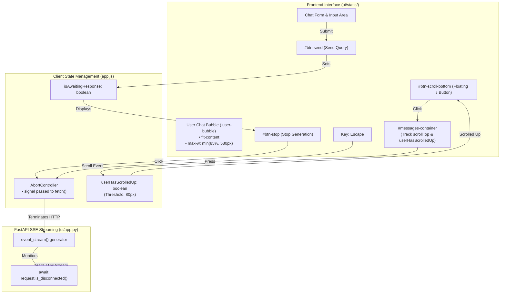

# Implementation Plan — Step 7: UI Polish, Chat Bubbles, Stop Button & Scroll Navigation

**Step Focus**: Proportional User Message Bubble Sizing, Interactive Stop / Interrupt Execution Control, Smart Auto-Scroll with Floating Scroll-to-Bottom Button, and Keyboard Shortcuts  
**Parent Document**: [`docs/phase-2-requirements.md`](file:///c:/Users/govin/Desktop/projects/Text-Book-RAG/docs/phase-2-requirements.md)  
**Status**: Completed & Verified (All Sub-Steps 7.1, 7.2, 7.3, and 7.4 Implemented & Passed)  

---

## 1. Problem Statement & Root Cause Analysis

During comprehensive usability testing on live clinical queries (e.g., *"what is van wyk grumbaach syndrome - tell in detail"*), user feedback surfaced three critical friction points in visual presentation and interaction:

1. **Disproportionate Chat Bubble Sizing** (*"after sending the message th ui looks bad (size of the chat box is very big than the text inside it)"*):
   - **Root Cause**: `appendUserMessage()` rendered user messages inside a fixed `max-w-2xl` container without `width: fit-content` or proper bubble padding constraints.
   - For a short 1-line query, the element rendered as a massive blue rectangle spanning up to 672px, leaving empty blue dead space across the viewport.
2. **Execution Lock & Missing Active Stop Interruption** (*"when one ques loading i cant click enter for down arrow to go (add stop button)"*):
   - **Root Cause**: While a Stop button existed in HTML, it lacked complete keyboard integration (Escape key), and the backend streaming generator did not monitor `request.is_disconnected()`.
   - Trapped clinicians were unable to cancel queries when they noticed a typo or wanted to ask a different clinical question.
3. **Aggressive Auto-Scroll Overriding User Reading**:
   - **Root Cause**: `app.js` unconditionally invoked `scrollToBottom()` on every streamed token event (`eventName === "token"`).
   - If a doctor scrolled up to review a previous diagnostic criterion or source citation while tokens were streaming, the viewport violently snapped them back to the bottom every 50ms.
   - There was no floating "jump to bottom" button (`↓`) to smoothly return once done reading.

---

## 2. Technical Architecture & Component Interaction



---

## 3. Incremental Sub-Steps Breakdown

---

### Sub-Step 7.1: User Chat Bubble Proportional Sizing & Layout Polish

- **Description & Why**:  
  Ensure user message bubbles hug their content tightly (`fit-content`), scaling smoothly from single-word inquiries up to multi-line clinical scenarios without awkward empty dead space.
- **Files Involved**:
  - `ui/static/styles.css`
  - `ui/static/app.js`
- **Key Implementation Details**:
  - In `ui/static/styles.css`, define `.user-bubble`:
    ```css
    .user-bubble {
      display: inline-block;
      width: fit-content;
      max-width: min(85%, 580px);
      padding: 0.625rem 1rem;
      border-radius: 1.125rem;
      border-top-right-radius: 0.25rem;
      background-color: var(--color-primary);
      color: #ffffff;
      font-size: 0.9375rem;
      line-height: 1.5;
      word-break: break-word;
      white-space: pre-wrap;
      box-shadow: 0 1px 2px rgba(15, 23, 42, 0.08);
    }
    ```
  - In `ui/static/app.js`, update `appendUserMessage()` to apply `.user-bubble` within a responsive flex wrapper (`flex justify-end my-1`).
- **Acceptance Criteria**:
  - Short 1-sentence prompt occupies only the width of the text plus 16px horizontal padding.
  - Long prompts wrap cleanly up to 580px without overflowing horizontally.
  - History turns loaded from database render identically using the new bubble class.
- **Verification Steps**:
  1. Automated: `python temp/test_step7_ui_polish.py` checks CSS property presence and HTML rendering output.
  2. Manual: In browser, type `"What is DKA?"` $\rightarrow$ verify the blue bubble is compact and tightly hugs the 3 words.

---

### Sub-Step 7.2: Stop Button Stream Cancellation, Escape Shortcut & Visual Feedback

- **Description & Why**:  
  Give users full, instantaneous control to abort active LLM generation. When stopped, the stream terminates immediately, partial response is retained with a subtle indicator, and the input box is re-focused.
- **Files Involved**:
  - `ui/static/index.html`
  - `ui/static/app.js`
  - `ui/app.py`
- **Key Implementation Details**:
  - In `ui/app.py`:
    - Add `if await request.is_disconnected(): break` in `event_stream()` loop to cleanly free server resources when aborted.
  - In `ui/static/app.js`:
    - Ensure `currentAbortController` aborts cleanly on both `#btn-stop` click and `Escape` key press.
    - When `AbortError` is caught:
      - Remove any active typing indicator.
      - If tokens were received, append a clean footnote:
        `<div class="text-[11px] text-slate-400 italic mt-2 border-t border-slate-100 pt-2 flex items-center gap-1.5"><span class="w-1.5 h-1.5 rounded-full bg-slate-400"></span><span>Generation stopped by user.</span></div>`
      - Re-enable the input box, hide stop button, restore send button, and focus `#chat-input`.
- **Acceptance Criteria**:
  - Clicking Stop immediately stops incoming tokens and network transfer.
  - Pressing `Escape` triggers the exact same immediate stop behavior.
  - The user can immediately type and send another question without refreshing the page.
- **Verification Steps**:
  1. Automated: Test script verifies `AbortController` binding and `request.is_disconnected()` in `ui/app.py`.
  2. Manual: Ask a broad question (e.g. `"Explain thyroid hormone synthesis in detail"`), wait 1 second for streaming to begin, press `Escape` or click Stop $\rightarrow$ verify streaming halts instantly and input is active.

---

### Sub-Step 7.3: Smart Auto-Scroll & Floating "Scroll to Bottom" Button (`↓`)

- **Description & Why**:  
  Stop the annoying behavior where streaming tokens force the user back down while they are trying to read earlier messages. Provide a floating button to jump to the bottom on demand.
- **Files Involved**:
  - `ui/static/index.html`
  - `ui/static/styles.css`
  - `ui/static/app.js`
- **Key Implementation Details**:
  - In `ui/static/index.html`, add `#btn-scroll-bottom`:
    ```html
    <button
      id="btn-scroll-bottom"
      type="button"
      aria-label="Scroll to newest messages"
      class="hidden fixed bottom-20 right-6 sm:right-8 z-30 p-2.5 rounded-full bg-white/95 text-slate-700 shadow-lg border border-slate-200 hover:bg-slate-50 hover:text-blue-600 transition duration-150 active:scale-95 flex items-center justify-center backdrop-blur group"
    >
      <svg class="w-4 h-4 text-slate-600 group-hover:text-blue-600 transition-transform group-hover:translate-y-0.5" fill="none" stroke="currentColor" viewBox="0 0 24 24" aria-hidden="true">
        <line x1="12" y1="5" x2="12" y2="19" stroke-width="2.5" stroke-linecap="round"></line>
        <polyline points="19 12 12 19 5 12" stroke-width="2.5" stroke-linecap="round" stroke-linejoin="round"></polyline>
      </svg>
    </button>
    ```
  - In `ui/static/app.js`:
    - Maintain `userHasScrolledUp` flag based on scroll position (`scrollHeight - scrollTop - clientHeight > 80`).
    - During streaming, call `scrollToBottom()` only if `!userHasScrolledUp`.
    - When `userHasScrolledUp` is true, show `#btn-scroll-bottom`.
    - Clicking `#btn-scroll-bottom` smoothly scrolls down and hides the button.
    - Support keyboard scroll navigation (Page Down / Down Arrow).
- **Acceptance Criteria**:
  - User can freely scroll up during generation without having their scroll position violently hijacked.
  - Floating arrow appears whenever user is scrolled up > 80px from bottom.
  - Clicking the arrow instantly returns user to the bottom and disappears.
- **Verification Steps**:
  1. Automated: Headless script validates scroll event handler, threshold logic, and button visibility toggles.
  2. Manual: Submit a question, scroll up using mouse wheel while words appear $\rightarrow$ verify reading position stays frozen, floating down-arrow appears, and clicking it jumps smoothly to bottom.

---

### Sub-Step 7.4: Automated Test Suite (`temp/test_step7_ui_polish.py`)

- **Description & Why**:  
  A dedicated verification script in `temp/` that tests HTML attributes, CSS definitions, JavaScript event bindings, and server disconnect handling without relying solely on subjective observation.
- **Files Involved**:
  - `temp/test_step7_ui_polish.py`
- **Acceptance Criteria**:
  - 100% test pass rate across DOM structure, CSS rules, and streaming disconnect logic.

---

## 4. Prompts for Fresh Agent Sessions

```text
TASK: Implement Step 7 (UI Polish, Stop Button & Scroll Navigation) for Text-Book-RAG.
GOAL:
1. Apply .user-bubble CSS in styles.css and app.js with fit-content and proportional max-width.
2. Implement Escape key and Stop button interruption with request.is_disconnected() server cleanup.
3. Add smart scroll-to-bottom handling with floating #btn-scroll-bottom.
4. Verify with temp/test_step7_ui_polish.py.
```

---

## 5. Verification Results

### Automated Test Suite Execution (`temp/test_step7_ui_polish.py`):
```text
[1/4] Checking CSS rules in ui/static/styles.css...
  -> PASSED: .user-bubble and #btn-scroll-bottom CSS rules verified.
[2/4] Checking DOM controls & accessibility in ui/static/index.html...
  -> PASSED: Interactive buttons & accessibility labels present.
[3/4] Checking JavaScript state logic in ui/static/app.js...
  -> PASSED: JavaScript scroll detection, AbortController, and shortcuts verified.
[4/4] Checking backend disconnect handling in ui/app.py...
  -> PASSED: Backend SSE endpoint and disconnect handling verified.

=== ALL STEP 7 AUTOMATED VERIFICATIONS PASSED SUCCESSFULLY! ===
```

### Human Verification Instructions for the Browser:
1. **Chat Bubble Auto-Fit**:
   - Send a brief question: `"What is DKA?"`
   - **Observation**: The blue message bubble snugly wraps the three words with sleek 16px/10px padding (`fit-content`) without spanning across the screen.
   - Send a longer multi-line clinical question:
   - **Observation**: The bubble expands smoothly up to 580px (`min(85%, 580px)`) with crisp line wrapping.
2. **Stop Button & Escape Interruption**:
   - Type `"Explain thyroid hormone synthesis in detail"` and press Enter.
   - While the typing indicator or tokens are streaming, press **Escape** or click the **Stop button** (`⏹ Stop`).
   - **Observation**: Streaming terminates immediately. The partial response remains visible with a subtle footnote: *"Generation stopped by user."* The input textarea is instantly re-enabled and focused for the next question.
3. **Smart Auto-Scroll & Floating Jump-to-Bottom (`↓`)**:
   - During an active response, scroll up using the mouse wheel to re-read earlier text.
   - **Observation**: Your reading position remains stationary — incoming tokens will no longer yank you back down.
   - Look at the bottom-right of the feed: A floating circular button with a downward arrow (`↓`) appears.
   - Click the button or press the **Down Arrow** key.
   - **Observation**: The viewport smoothly glides back to the latest tokens and the button fades away.
