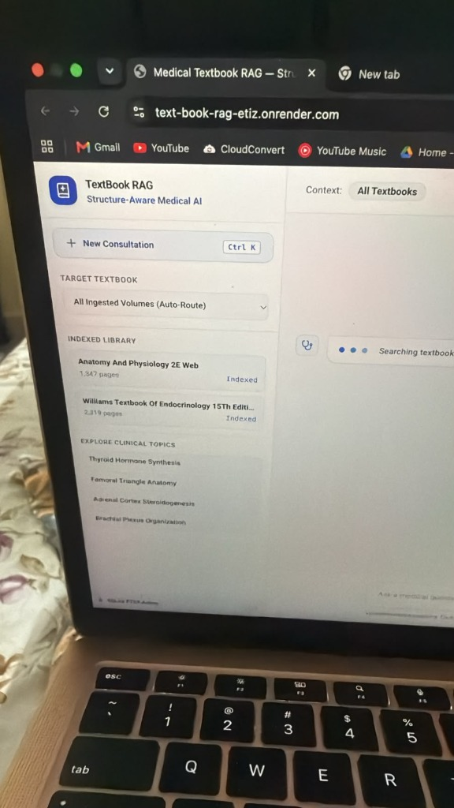
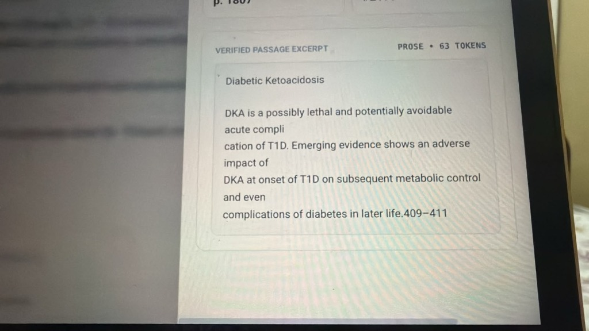
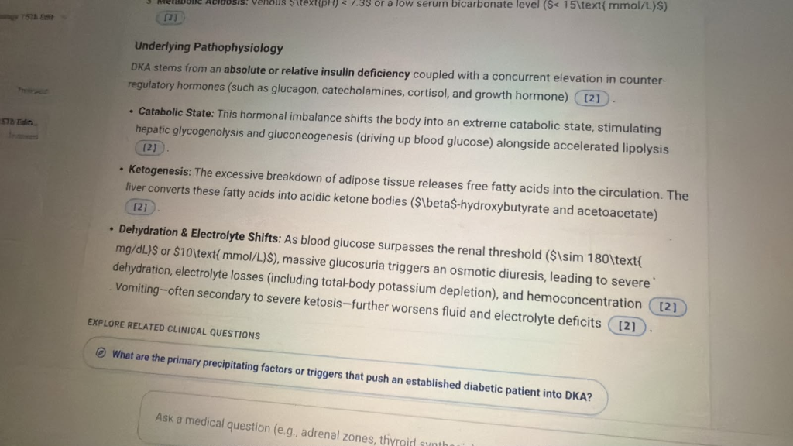
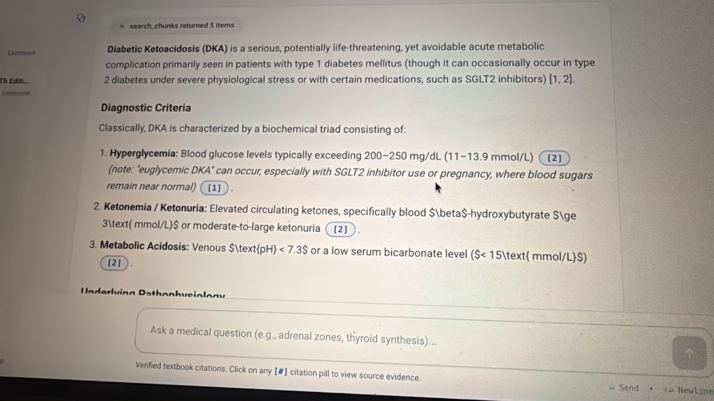
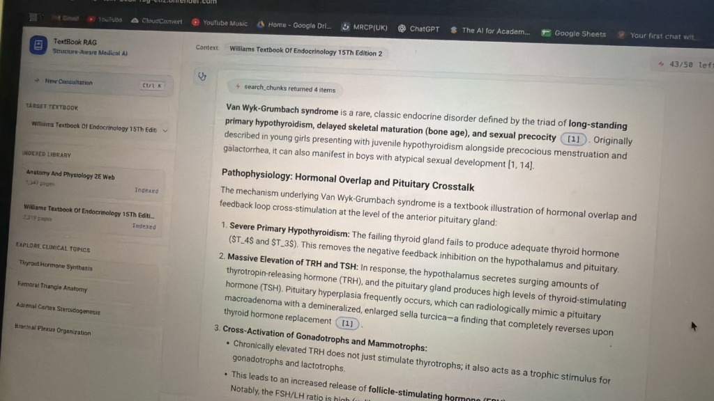
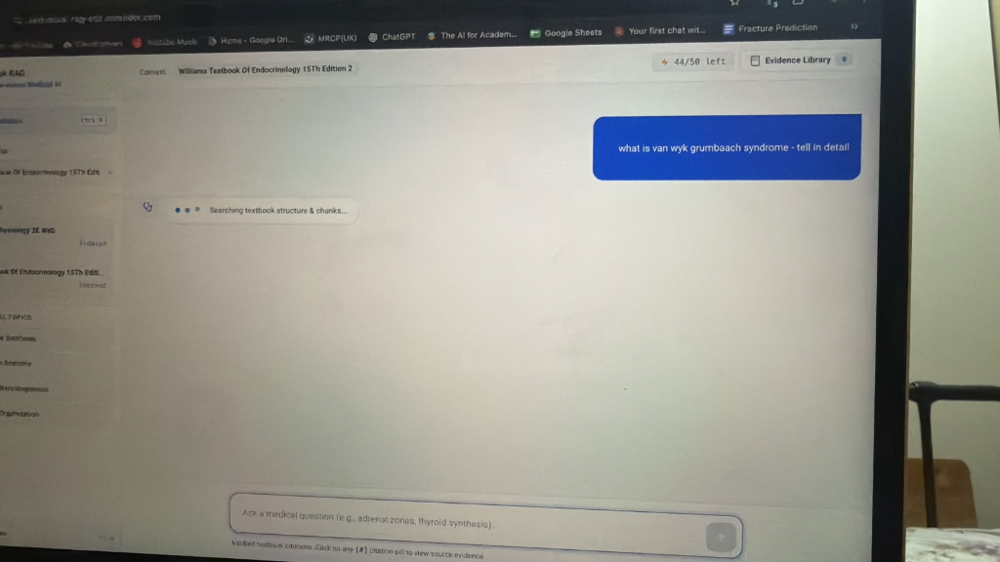
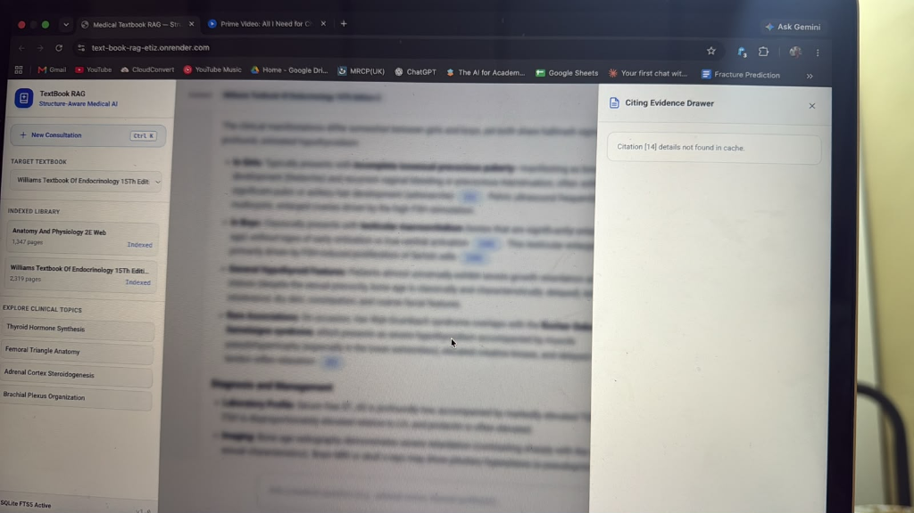
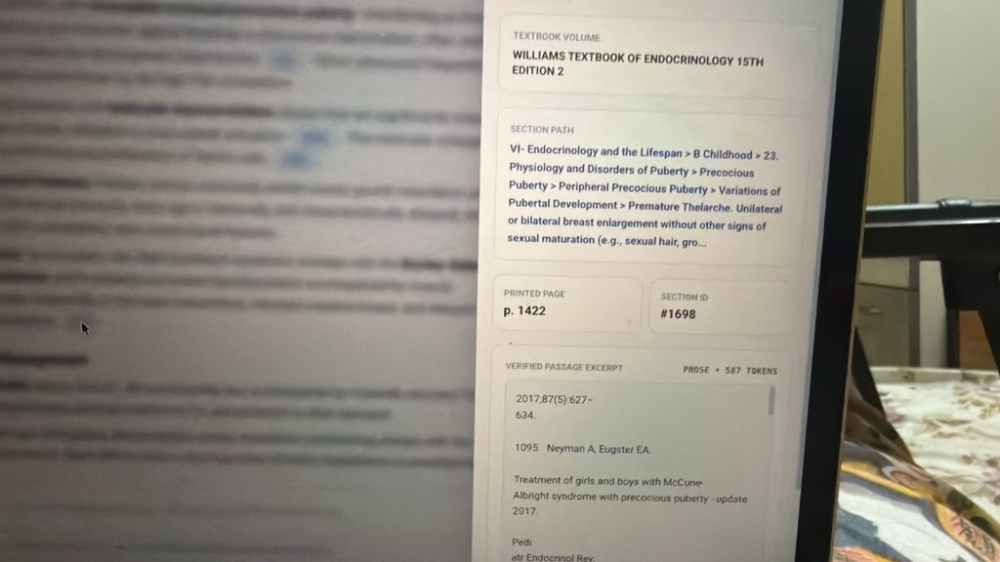

# User Feedback & Observations Log

This document tracks direct user feedback, pain points, feature requests, and visual captures collected during usability testing. All raw and synthesized feedback will be maintained here and used as the foundation for the **Phase 2 Requirements Document**.

---

## Feedback Session 1 (Initial Web App Testing)

**Date**: October 29, 2026  
**Environment**: Live Deployment (`text-book-rag-etiz.onrender.com`)  
**Context Image**:

---

### Itemized Feedback & Detailed Breakdown

#### 1. Consultation / Chat History Missing in Sidebar
- **User Feedback**: *"left side past history chat dhi ledu"* (There is no past chat history on the left side).
- **Current State**: The left sidebar currently only houses the *New Consultation* button, *Target Textbook* selector, *Indexed Library* list, and *Explore Clinical Topics*. There is no session persistence, conversation list, or ability to revisit previous queries or consultations.
- **Pain Point**: Users lose context when starting a new consultation or refreshing the browser. They cannot compare answers from prior sessions or resume a case study.
- **Identified Need**:
  - Implement a session/consultation manager with persistent conversation history stored in localStorage or database.
  - Dedicated "Past Consultations" / "Recent History" section on the sidebar with title, timestamp, and delete/rename options.

---

#### 2. Indexed Library Management & Textbook Deletion/Filtering
- **User Feedback**: *"target textbook is nice, but i dont want anatomy book - i cant delete it, it is still there, i cant edit indexed, lib"*
- **Current State**: The UI lists static indexed books (*Anatomy And Physiology 2E Web*, *Williams Textbook Of Endocrinology 15Th Edition*). The user cannot exclude, delete, hide, or deactivate a book from the index or from their active search scope.
- **Pain Point**: If a clinician/student only wants answers from *Endocrinology*, having unwanted books in the library creates noise, or they might want to remove textbooks they don't use.
- **Identified Need**:
  - Ability to delete/remove or toggle/deactivate specific textbooks from the indexed library.
  - Scope controls (per-session or global) allowing the user to select specific subset(s) of books rather than just "All" or a single book.
  - Library management drawer or modal with edit, disable, or delete capabilities.

---

#### 3. Execution Control & UI Responsiveness (Stop / Cancel Button)
- **User Feedback**: *"when one ques loading i cant click enter for down arrow to go (add stop button)"*
- **Current State**: When a question is submitted and in the `Searching textbook...` / `Thinking` phase, the input box and send button are disabled, and there is no way to cancel or interrupt the agent/stream. The user is locked until the response finishes or times out.
- **Pain Point**: If the user submits a typo, realizes they asked the wrong question, or the agent takes too long on a complex retrieval, the user is trapped waiting. Also, navigation/scrolling shortcuts (Enter / down arrow) get blocked or unresponsive during generation.
- **Identified Need**:
  - Add an explicit **Stop / Interrupt** button (`AbortController` on the frontend, cancelling backend streaming task/generator).
  - Ensure scroll-to-bottom and keyboard navigation remain accessible while generating.
  - Re-enable input or allow queuing the next query.

---

#### 4. Medical Diagrams & Visual Illustrations
- **User Feedback**: *"nice but no diagram (fetch 4 to 5 related diagrams (if necessary))"*
- **Current State**: The current RAG response returns text, citations, and metadata cards. Embedded textbook figures, anatomical diagrams, anatomical plates, and hormone pathways are not extracted or rendered in the answer stream.
- **Pain Point**: Medical study and clinical consultation are heavily visual (e.g., anatomical relations, steroidogenesis pathway charts, histological diagrams). Pure textual answers lack the high-yield visual clarity expected from medical textbooks.
- **Identified Need**:
  - Multimodal retrieval or visual asset indexing (e.g., extracting diagrams/figures with captions during ingestion or indexing PDF figures).
  - Fetching and displaying 4–5 relevant diagrams/figures alongside or within the answer.
  - Diagram viewer with zoom, full-screen lightbox, and source figure captions.

---

#### 5. Citation Drawer / Evidence Card Clarity & Jargon
- **User Feedback**: *"what is this (she didn't understand the image)"*
- **Context Image**:
  
- **Current State**: Clicking a citation badge opens an inspector showing:
  - Header: `VERIFIED PASSAGE EXCERPT`
  - Badges: `p. 1807`, `#2179`, `PROSE • 63 TOKENS`
  - Text box with raw extracted text containing PDF hyphenation artifacts (e.g. `compli \n cation`).
- **Pain Points**:
  1. **Developer jargon confusing to clinicians**: Labels like `"PROSE • 63 TOKENS"` and `"#2179"` are LLM/RAG engineering internals. To a medical student or doctor, they have no clinical meaning and cause cognitive overload.
  2. **Unclear purpose**: It is not immediately obvious that this is the exact textbook excerpt supporting the AI's generated claim (e.g., missing clear title like *"Source Quote from Williams Textbook of Endocrinology, Ch. 31, Page 1807"*).
  3. **Broken text formatting / line breaks**: Hard line breaks and split words (e.g., `compli` / `cation`) from PDF extraction make it look like a bug or corrupted text.
- **Identified Need**:
  - Redesign evidence cards with human-centered medical UI: Replace `"PROSE • 63 TOKENS"` with clean metadata (e.g., *“Chapter 31: Diabetes Mellitus • Page 1807”*).
  - Add text de-hyphenation / normalization during chunk rendering.
  - Add a clear header: *"Exact Textbook Excerpt Supporting This Answer"*.
  - Optionally provide a *"View Original Page"* or *"Open in PDF"* action if possible.

---

#### 6. Broken Unit & Scientific Notation Rendering (Literal `\text{...}`, `$T_4$ and $T_3$`)
- **User Feedback**: 
  - *"units are wring"*
  - *"point 1 correct units"*
  - *"point 3 wrong : says text - no ala odu"*
  - *"wow good but units all wrong"* (Validating that while the clinical explanation of *Van Wyk–Grumbach syndrome* is high quality, the chemical/hormone notation is ruined by LaTeX markup).
- **Context Images**:
  - Breakdown image: 
  - Full answer comparison image: 
  - Hormone notation image: 
- **Pain Points**:
  1. In Point 1 of DKA, standard text `200–250 mg/dL (11–13.9 mmol/L)` displayed seamlessly.
  2. In Point 2 & 3 of DKA, the model wrapped units in LaTeX `\text{pH}` and `\text{ mmol/L}`, causing raw code `\text` to literally appear in the UI.
  3. In Van Wyk–Grumbach syndrome, common thyroid hormones are rendered with raw dollar signs and underscore subscripts: `($T_4$ and $T_3$)`. In clinical medicine, this should simply be `T4 and T3` or `T₄ and T₃`.
- **Identified Need**:
  - **Medical Typography Standard**: The system prompt must enforce standard clinical notation rules:
    - Write hormone names and abbreviations as plain text: `T4`, `T3`, `fT4`, `fT3`, `TSH`, `TRH`, `ACTH`, `FSH`, `LH`.
    - Write clinical units in plain text: `mg/dL`, `mmol/L`, `mIU/L`, `ng/dL`, `mcg/day`.
    - Never wrap hormones, units, or clinical parameters in LaTeX math mode (`$...$`).
  - **Frontend Safeguard**: Strip accidental `$`, `_` math wrappers and `\text{}` commands before rendering in marked.js if KaTeX is not specifically needed.

---

#### 7. Answer Depth & Comprehensiveness (Avoiding Superficial Short Answers)
- **User Feedback**: *"and short answers istundi, detailed ivali konchem, ah concept varku cover cheyali depth boundaries una"* (It is giving short answers; it should give detailed answers and thoroughly cover that concept in depth within medical boundaries).
- **Current State**: The agent currently produces concise, summary-level answers (approx. 200–300 words) with high-level bullet points.
- **Pain Point**: Medical textbooks provide deep, rigorous, multi-faceted coverage (etiology, detailed pathophysiology, diagnostic triad with laboratory cutoffs, differential diagnosis, acute emergency management protocols, complications). Brief summaries fail to satisfy medical professionals or students studying high-stakes topics (e.g., DKA, thyroid crisis, adrenal insufficiency).
- **Identified Need**:
  - Configurable or default depth: Generate comprehensive, textbook-grade explanations covering the full clinical breadth of the queried topic (pathophysiology, clinical presentation, diagnostic criteria, protocols, complications) bounded strictly by the textbook sources.
  - Multi-hop retrieval: Perform deeper chunk searches to assemble complete topic coverage rather than retrieving only 5 isolated chunks.

---

#### 8. Flowcharts, Clinical Algorithms & Decision Diagrams
- **User Feedback**: *"also images flow charts ivali"* (Must also provide images and flowcharts).
- **Current State**: The system returns only text. Standard medical diagnostic and treatment pathways are published as clinical flowcharts/algorithms in textbooks (e.g., DKA fluid resuscitation algorithm, diagnostic trees).
- **Pain Point**: Understanding emergency protocols and diagnostic decision steps in pure text is cumbersome and harder to memorize/apply clinically compared to visual flowcharts.
- **Identified Need**:
  - Extract and index flowchart figures from textbook PDFs.
  - Render interactive Mermaid.js diagrams or structured clinical decision trees natively in the response when an algorithm is described.
  - Provide corresponding textbook algorithm figures.

---

#### 9. User Chat Bubble Sizing & Visual Polish
- **User Feedback**: *"after sending the message th ui looks bad (size of the chat box is very big than the text inside it)"*
- **Context Image**:
  
- **Current State**: When a user submits a query (e.g. *"what is van wyk grumbaach syndrome - tell in detail"*), the user message container renders with excessive padding, fixed min-width or improper flex sizing, creating a massive blue block for a single sentence.
- **Pain Points**:
  1. **Visual imbalance**: The user bubble takes up huge vertical and horizontal real estate disproportionate to the text content, making the UI look unpolished and clunky.
  2. **Wasted screen space**: Pushes incoming responses down and creates empty blue dead zones.
- **Identified Need**:
  - Set chat bubbles to auto-fit / `fit-content` with sensible `max-width` (e.g., `max-w-[75%]` or `max-w-xl`), standard proportional padding (`py-2.5 px-4`), and rounded corners.
  - Ensure message bubbles adapt smoothly to content length (both short 1-line queries and longer clinical prompts).

---

#### 10. Citation Index Discontinuity & Broken Reference Cache (`[14]` Missing in Cache)
- **User Feedback**: *"citations 1 nundi direct 14, 2-13 lev, 14 not working"* (Citations jump from 1 directly to 14 without 2–13, and clicking 14 does not work).
- **Context Images**:
  - Cache Error Drawer: 
  - Answer Text with [14] Jump: ![Answer Text Jumping to [14]](feedback/images/user_feedback_8_citation_14_text.png)
- **Current State & Root Cause**:
  1. **Source Bibliography Leakage**: In the source textbook (*Williams Endocrinology*), the authors cited their own internal literature reference `[14]` for Sertoli cell proliferation. The LLM copied the literal citation `[14]` directly from the textbook text into its generated answer.
  2. **RAG Cache Mismatch**: In this consultation turn, the RAG agent only retrieved **4 chunks** (`search_chunks returned 4 items`). The frontend only has cached citation metadata for indices `[1]`, `[2]`, `[3]`, and `[4]`.
  3. **Broken User Interaction**: When the user clicks the pill `[14]`, the frontend drawer searches for chunk index `14`, fails, and displays the error: `Citation [14] details not found in cache.`
- **Pain Points**:
  - The jump from `[1]` to `[14]` looks confusing and erroneous to users.
  - Clicking on citation pills fails, breaking the primary trust proposition of verified textbook citations.
- **Identified Need**:
  - **Prompt Citation Contract Enforcement**: Enforce strictly in the prompt that citation numbers MUST only refer to retrieved chunk indices `[1]` through `[N]`. Never copy internal textbook reference numbers from the raw text.
  - **Citation Re-indexing / Normalizer**: Add an agent-side or backend post-processing validation step that scans generated citation brackets `[X]` and validates them against the actual retrieved chunk list before sending to the client, remapping or dropping orphaned references.
  - **Graceful Frontend Fallback**: If an unindexed citation is clicked, provide context instead of an unhelpful error message.

---

#### 11. Section ID Confusion, Bibliography Chunk Ingestion & Page Number Accuracy
- **User Feedback**: *"section id enti, page no correct eh na"* (What is Section ID? Is the page number even correct?)
- **Context Image**:
  
- **Current State & Observations**:
  1. **Internal Developer Metric Exposed**: The drawer displays `SECTION ID: #1698`. This is an internal database row/chunk ID that is meaningless to doctors and clinical learners.
  2. **Bibliography Chunks Retrieved as Clinical Evidence**: The *"VERIFIED PASSAGE EXCERPT"* displays:
     > `2017;87(5):627-634.`  
     > `1095. Neyman A, Eugster EA.`  
     > `Treatment of girls and boys with McCune-Albright syndrome with precocious puberty - update 2017.`  
     The RAG engine retrieved and cited the end-of-chapter bibliography references instead of the actual clinical prose describing the syndrome!
  3. **Page Number Doubts**: Because the user sees a bibliography citation on `p. 1422` instead of clinical explanation, they doubt whether `p. 1422` corresponds to the actual book's printed page or an uncalibrated PDF page offset.
- **Pain Points**:
  - Users lose trust when clicking a citation expecting clinical evidence and finding an academic bibliography citation snippet.
  - Displaying raw database IDs (`#1698`, `587 TOKENS`) makes the product feel like an unfinished developer prototype rather than an authoritative medical tool.
- **Identified Need**:
  - **Filter Out Bibliography / References Chunks**: Ingestion pipeline and chunking should detect and tag/filter out back-matter references, literature bibliographies, and index pages so they are not retrieved as primary medical evidence.
  - **Hide Internal Section IDs**: Remove `#1698` from the UI; replace with clean, clinician-friendly breadcrumbs (e.g. `Chapter 23 > Disorders of Puberty`).
  - **Page Number Calibration**: Calibrate printed book page numbers vs. PDF absolute page numbers to guarantee 100% precision when a student cross-checks a physical textbook.

---

#### 12. Response Latency & Speed of Answering (Time-to-First-Token)
- **User Feedback**: Long wait times during generation; need for faster answers.
- **Current State & Bottlenecks**:
  1. **Multi-Turn Agent Loop Overhead**: The ReAct agent performs sequential steps: `Question` -> `LLM Call 1 (Plan & Search Call)` -> `SQLite FTS5 / Vector Retrieval` -> `LLM Call 2 (Evaluate Evidence or Follow-up Search)` -> `LLM Call 3 (Final Synthesis & Citation Generation)`.
  2. **High Time-to-First-Token (TTFT)**: Each sequential LLM round-trip takes 2–4 seconds over API, leading to a 6–12+ second delay before the user sees the first word of the answer.
  3. **Serverless / Container Cold Starts & Resource Limits**: Hosted on Render with single-core/limited RAM, cold starts and synchronous database operations create perceived sluggishness.
- **Pain Points**:
  - In a clinical ward or study session, waiting 10–15 seconds while looking at a spinning `Searching textbook...` indicator causes impatience and friction.
  - Users think the app has frozen or crashed (which also triggers the desire for a stop button or reloading the page).
- **Identified Need**:
  - **Optimized Retrieval Pipeline / Hybrid Direct Route**: For standard direct medical questions, bypass multi-step iterative LLM reasoning and run direct single-shot hybrid search (FTS5 + dense vector) immediately, cutting TTFT down to under 2 seconds.
  - **Immediate Progressive Streaming**: Stream the retrieved chapter/section breadcrumbs and thoughts immediately as they are discovered so the user sees live progress before synthesis starts.
  - **Backend Caching & Index Optimization**: Add SQLite in-memory / LRU caching for frequent clinical queries, embeddings, and query embeddings.
  - **Asynchronous Concurrent Retrieval**: Parallelize textbook structure lookup and chunk semantic search rather than executing sequentially.

---

## Log for Upcoming Feedback
*(Awaiting additional user feedback items from subsequent tests...)*

